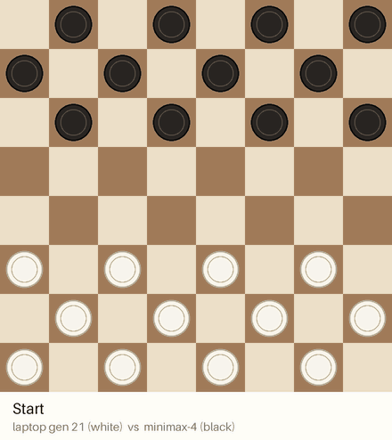

# warcaby-zero

An AlphaZero-style AI for 8x8 international draughts ("warcaby"), written from scratch in
Python and PyTorch. It starts with the rules and a randomly initialised network, plays against
itself, and learns from nothing but the results of its own games. No human games, no opening
book, no hand-written evaluation.



<!-- RESULTS -->

## How it works

**The loop.** Every iteration does three things:

1. **Self-play.** The best network so far plays a few hundred games against itself. Moves are
   chosen by a tree search (MCTS) that the network guides. Every position is stored with two
   labels: how the search divided its attention among the moves, and who won in the end.
2. **Training.** A candidate network learns from those positions: its *policy* output is pulled
   towards the search's move distribution, its *value* output towards the game results.
3. **Arena.** The candidate plays the current best network. It replaces it only if it scores at
   least 55%. Each replacement is a new *generation*.

**Where does the knowledge come from?** Only from the rules and from who won. The search is what
turns that into progress. Given a network, MCTS looks ahead and comes back with a better choice
of move than the network would make alone, because it checks the network's hunches against what
actually happens a few moves later. Training the network to imitate the search makes the hunches
better, the next search starts from a better place, and the cycle repeats. The value output is
anchored to reality by the only ground truth there is: finished games.

**MCTS in one paragraph.** The search grows a tree one position at a time. Each *simulation*
walks from the current position down the tree, always picking the move with the best score
`Q + c * P * sqrt(N) / (1 + n)`, where `Q` is the average result seen so far below that move
(prefer what worked), `P` the network's prior for it (prefer what looks promising), and the
fraction shrinks the more often the move has been tried (do not get stuck on the first idea).
At a position not seen before, the network is asked for priors and a value, the position joins
the tree, and the value travels back up the path with its sign flipped at every step, because
what is good for one player is bad for the other. After a hundred or so simulations the visit
counts are the verdict. See [`mcts.py`](src/warcaby/mcts.py).

**What the network sees.** The board is always shown from the side of the player to move (for
Black it is rotated and the colours are swapped), as six 8x8 planes: own men, own kings, the
opponent's men and kings, the no-progress clock and the repetition count. A whole move, including
a multi-capture, is one action identified by its start and end square (32 x 32 = 1024 outputs).
Two different captures can share both squares; they then share one network output and the search
tells them apart. See [`draughts/game.py`](src/warcaby/draughts/game.py).

**Symmetries.** Go has eight board symmetries to augment the data with; draughts has almost none.
A mirror image puts the pieces on the light squares, and turning the board makes men walk
backwards. The one real symmetry (swap colours and rotate) is used up by always showing the board
from the mover's side. Only positions with no men left, kings only, have four equivalent images,
and those are used.

## The game

International rules on an 8x8 board (this variant is also known as Brazilian draughts):

- men move forward, capture forwards and backwards; kings fly any distance along a diagonal,
- capturing is mandatory, and you must take the largest number of pieces available,
- a multi-capture is one move; the pieces taken are removed only when it is finished, so a piece
  cannot be jumped twice and still blocks the way,
- a man that only passes through the last row during a capture is not crowned,
- draws: threefold repetition, 15 moves each with only king moves and no capture, and (in
  training only) a cap on the game length.

The engine is parameterised by board size, so `Draughts(10)` is international draughts on 10x10.
That gives an outside check for free: move counts from the 10x10 starting position match the
[published perft numbers](https://damforum.nl/viewtopic.php?p=64993) to depth 7 (1,049,442
positions), and the same code runs the 8x8 game. The tests also cover each rule with a named
position and compare the move generator with an independent, naive implementation over thousands
of random positions on 6x6, 8x8 and 10x10 boards.

## Quick start

Requires [uv](https://docs.astral.sh/uv/).

```bash
uv sync                     # Python 3.12 and all dependencies
uv run pytest               # the test suite (about 20 s)
```

Train. Runs can be stopped at any time and continue when started again with the same `--run-dir`.

```bash
# a few minutes: proves the whole loop works; beats random play after two iterations
uv run python -m warcaby.train --preset quick --run-dir runs/quick --iterations 10

# about an hour on an Apple-silicon laptop
uv run python -m warcaby.train --preset laptop --run-dir runs/laptop --hours 1.2

uv run tensorboard --logdir runs
```

Evaluate and draw the charts:

```bash
uv run python -m warcaby.evaluate tournament --run-dir runs/laptop
uv run python -m warcaby.evaluate plots --run-dir runs/laptop
```

Play against it in the browser (the newest generation in `runs/` is used):

```bash
uv run python -m warcaby.app
```

The app shows what the AI thinks of the position and of every legal move: the network's first
impression, how much of the search each move received, and the expected result. Two people can
also play each other at one computer; results are kept in `data/games.db` and shown as standings.

Record a game as a GIF:

```bash
uv run python -m warcaby.render --opponent minimax --depth 4 --out docs/game.gif
```

## Training on a free Kaggle GPU

1. On Kaggle create a notebook from [`notebooks/kaggle_train.ipynb`](notebooks/kaggle_train.ipynb)
   (*File → Import notebook*), set the accelerator to **GPU T4 x2** and turn the internet on.
   The notebook clones this repository; point `REPO_URL` at your fork to train your own changes.
2. *Save Version → Save & Run All (Commit)*. The notebook trains for 11 hours in the background,
   then runs the tournament and draws the charts.
3. To continue in a later session, attach the previous version's output (*Add Input → Notebook
   Output*) and run it again. The newest checkpoint is found and training carries on.
4. Download `runs/kaggle` from the output and put it into `runs/` here to play against it.

Self-play is parallel on two levels: each worker process plays 64 games side by side and sends
their positions to the GPU in one batch, and there is one worker per CPU core.

## Layout

```
src/warcaby/
  game.py           the Game interface everything else is written against
  draughts/         rules engine (rules.py) and network encoding (game.py)
  players.py        random and minimax (alpha-beta) opponents
  net.py            ResNet with policy and value heads
  evaluators.py     network / heuristic / rollout evaluators for the search
  mcts.py           the tree search, batched across many games
  selfplay.py       playing many games at once, in several processes
  buffer.py         replay buffer
  train.py          the self-play -> training -> arena loop, checkpoints, TensorBoard
  elo.py            Elo ratings by maximum likelihood
  evaluate.py       tournament between generations and baselines
  plots.py          progress charts
  render.py         game -> GIF
  app/              the web app (FastAPI + a single page)
notebooks/          the Kaggle notebook
tests/              rules, search, training loop, evaluation, app
```

Search, self-play and training only use the [`Game`](src/warcaby/game.py) interface. Another
board size is a constructor argument (`board_size=10` in the configuration); another game means
implementing that one class.
